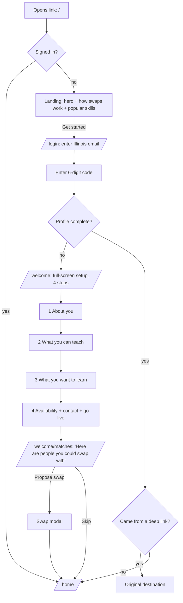
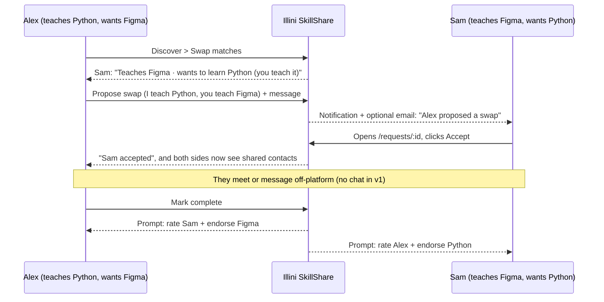
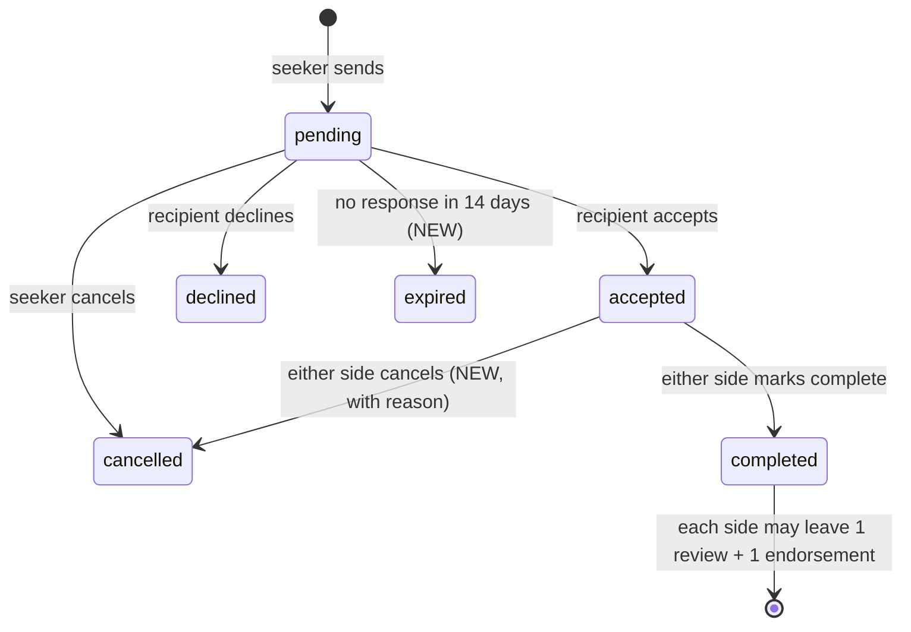

# Illini SkillShare: Product Context and Launch Plan

Read this file before starting any product, UX or feature work. `AGENTS.md` holds the engineering rules, and this file holds the product direction. If the two conflict, follow `AGENTS.md` and flag the conflict to the user.

Last mapped: Oct 18, 2026, against `main` @ `72ecdff` (all ten stacked PRs #17–#26 merged).

---

## 1. TL;DR

- **The infrastructure is solid, but the product doesn't hold together yet.** Auth, privacy, request transactions, notifications, ranking, Docker and CI are all built and tested. What's missing is the product layer. A new user lands on the page, signs in, fills a 6-step form inside the full app sidebar, and arrives at a dashboard full of zeros. Nothing walks them to a first swap.
- **It isn't a skill swap yet.** Today the only interaction is a one-way "help request". Students already save private *learning goals*, but nothing pairs "I teach X, you teach Y."
- **The name is inconsistent.** The code and docs use "UIUC SkillShare", "Illini SkillSwap" and `skillswap_backend` interchangeably. **Decision: the brand is "Illini SkillShare"** (see §3).
- **Plan:** seven phases, each one shippable on its own (§9). Phases 0–3 turn this into a usable app, Phases 4–5 make it safe to open to real students, and Phase 6 is launch.

---

## 2. What exists today (verified on `main`)

### Stack
- **Frontend:** React + TypeScript + Vite + Tailwind + React Router + TanStack Query in `frontend/src`.
- **Backend:** Django REST in `backend/`, with apps `accounts`, `profiles`, `taxonomy`, `discovery`, `interactions` and `common`. The Django project module is `skillswap_backend` (an internal name; do **not** rename it).
- **Data:** PostgreSQL 16 + pgvector (canonical), Redis for throttling and RQ jobs, Mailpit for local email.
- **Run:** `cp .env.example .env && docker compose up --build --wait` serves the app at http://localhost:8080, with the local inbox at http://localhost:8025.
- **Validate:** `make check` runs backend tests, frontend tests/lint/types/build, the Playwright two-member journey with accessibility checks, production config checks, DB permission checks and a backup/restore rehearsal.

### Features that work end to end
| Area | State |
|---|---|
| Sign-in | Illinois-email one-time code (works locally via Mailpit). Google sign-in is wired but needs a real OAuth client. Server sessions + CSRF. |
| Profile | Offered skills (with level and description), private learning goals, availability, contact methods (shared only after a request is accepted), evidence links, avatar, visibility, open-to-connect flag. |
| Discovery | Keyword + taxonomy-alias search, filters, explainable ranking (`docs/matching.md`), recommendations driven by learning goals. Semantic search exists but is disabled (paid calls are off with a $0 allowance). |
| Requests | `pending → accepted / declined / cancelled`, `accepted → completed`. Version checks, idempotency keys and a duplicate-topic constraint. |
| Feedback | One review + one skill endorsement per *completed* request, written by the seeker about the helper only. |
| Notifications | Persisted, with read state. Optional email goes through a retrying outbox. |
| Safety | Block, report, private profiles, account export and deletion, admin moderation with audit records. |
| Ops | Docker Compose, CI, Supabase migration prepared (not hosted), production settings checks. |

### Current routes (`frontend/src/app/routes.tsx`)
Public: `/`, `/login`. Protected (all inside `AppLayout` with an 8-item sidebar): `/dashboard`, `/discover`, `/profiles/:id`, `/onboarding`, `/profile/edit`, `/saved`, `/connections`, `/requests`, `/settings`, `/analytics`.

### Open GitHub items
- Issue #5, portfolio readiness tracker (needs updating now that the stack is merged).
- Dependabot PRs #27, #28, #29 (frontend, python, actions bumps). Review these separately.

---

## 3. Brand decision

**Name: Illini SkillShare.** Tagline: *"Trade what you know for what you want to learn."*

Why this name:
- "Illini" is how students refer to themselves. "UIUC" reads like an institutional acronym.
- "Share" covers both kinds of exchange (one-way help *and* two-way swaps), where "Swap" implies every interaction must be reciprocal.
- It matches the repo name (`uiuc-skillshare`).

Rules:
- User-facing copy, `<title>`, logo, emails, README, docs and AGENTS.md all say **Illini SkillShare**.
- Internal identifiers (`skillswap_backend`, DB names, compose service names, env vars, package names) stay unchanged. Renaming them is churn with migration risk.
- Logo subtitle: "Peer skill exchange" (replaces "Peer Network").
- Never imply university endorsement. Keep the existing disclaimer: *"An Illinois email establishes access, not university approval or verified enrollment."*
- Open item before any public launch: "Skillshare" is a registered trademark of Skillshare Inc., and "Illini" is a University of Illinois mark. That's fine for a student project, but check before marketing it publicly (§11).

Places to change (grep for `SkillSwap|SkillShare`): `Logo.tsx`, `LandingPage.tsx`, `LoginPage.tsx`, `ProtectedRoute.tsx`, `SettingsPage.tsx`, `useAuth.tsx`, `lib/auth.ts`, `lib/api.ts`, `frontend/index.html`, `backend/common/notifications.py` (email copy), `backend/accounts/lifecycle.py`, `README.md`, `AGENTS.md`, `docs/*`, plus any tests asserting on those strings.

---

## 4. Problems found in the current product

These are concrete findings with file references, grouped by the journey stage where a user hits them.

### First impression (landing + login)
1. The hero button **"Explore how it works" does nothing** (`LandingPage.tsx`, a `<button>` with no handler).
2. The primary CTA says **"Sign in or try the local demo"**. Developer copy is leaking to users.
3. The "Trust & Privacy" section talks about "Local demo access" and "Optional Google sign-in requires configuration". More developer copy.
4. The landing page never explains the **swap** idea, and its fake preview cards use made-up names.
5. A signed-in user who visits `/` still sees the marketing page instead of their app.
6. There are no privacy policy, terms or community guidelines pages, which a real launch requires.

### Onboarding
7. Onboarding renders **inside the full app shell** (sidebar, search, notification bell), so users can wander off mid-setup.
8. There are **six steps**, including "Optional Credentials" and a separate "Contact Methods" step. That's too long for a first visit.
9. Validation runs only on the final click, and **any error jumps back to step 1**, even when the actual problem is a missing skill (`OnboardingPage.tsx` `publish()`).
10. **Bio is required** (frontend `validateProfileForm` and backend `StudentProfile.update_onboarding`) but isn't marked with `*`.
11. Learning goals are buried at the bottom of the skills step, even though they're the core input for swaps.
12. After publishing, the user lands on a dashboard that says **"Welcome back"** (on a first visit) and shows 0/0/0 stats.

### Core loop (find someone → swap → finish)
13. **No reciprocal swap concept.** `HelpRequest` has no "what I offer in return" field, and discovery has no mutual-match mode.
14. Learning goals are **private**, so nobody can see that you'd be a good swap partner for them.
15. Profile pages put "Copy Email" and contact info first, which conflicts with the consent model where contacts appear only after acceptance.
16. **Feedback lives on the other person's profile page** behind "Add Review" / "Endorse Skill" plus a "choose an interaction" dropdown. It should happen on the completed request.
17. A review is `OneToOneField(help_request)`, so **only one side can ever review**. Swaps need both sides.
18. Requests, Connections and Saved are **three separate pages**, but Connections is just accepted and completed requests.
19. There's no request detail page, so notifications can't deep-link to a specific request.
20. Pending requests never expire.
21. Block and report use `window.confirm` / `window.prompt`.

### Navigation and polish
22. Eight sidebar items, and **Analytics is shown to every user** even though network stats are staff-only.
23. The mobile bottom nav shows Dashboard, Discover, Saved, Connections and Analytics, which **leaves out Requests and Profile**, the two pages users need most on a phone.
24. Discovery shows a "Use semantic matching" checkbox and "Matching mode: keyword_taxonomy" text. That's jargon, and semantic search is off anyway.
25. The year filter is missing Graduate, Alumni and Other.
26. Discovery pagination is unstyled plain buttons.
27. Mock/demo branches (`shouldUseMocks()`, `data/mockData.ts`) are spread across about 29 files and complicate every page.

---

## 5. Product principles (use these to settle UX questions)

1. **Every screen has one obvious next step.** No dead ends, and no dashboards of zeros without a call to action.
2. **Swap first, help always.** The default action is "Propose a swap" when there's a mutual match, otherwise "Ask for help". Nobody is required to give something back.
3. **Consent before contact.** Contacts appear only after acceptance. This is already enforced on the server, and the UI must never suggest otherwise.
4. **Honest signals.** Skills are self-declared, and feedback confirms an interaction happened, not expertise. Never invent qualifications.
5. **Fast first value.** A new user should see real people they could swap with within about 2 minutes of opening the link.
6. **The server is the authority.** All rules stay enforced in Django. The frontend only reflects them.

---

## 6. Target experience: what a new user sees

### 6.1 The new-user journey

### 6.2 The core loop (two members, Alex and Sam)

### 6.3 Request / swap state machine (extends the existing one)

---

## 7. Target information architecture (screen map)

### Public (signed out)
| Route | Screen | Purpose / primary action |
|---|---|---|
| `/` | Landing | Hero ("Trade what you know for what you want to learn"), a 3-step "How a swap works" with anchor `#how-it-works`, popular skill categories from the taxonomy API, trust section, CTA **Get started**. Signed-in users are redirected to `/home`. |
| `/login` | Sign in | Email step, then code step (resend, change email). Google button when configured. The demo button exists only in mock mode. |
| `/guidelines` | Community guidelines | Short and human: be respectful, show up, no spam or selling, how reporting works. |
| `/privacy`, `/terms` | Legal | Plain-language privacy (what's public, what's shared after acceptance, deletion/export) and terms. |
| `*` | 404 | Link home. |

### Setup (signed in, profile incomplete): full-screen, no app shell
| Route | Step | Fields | Required |
|---|---|---|---|
| `/welcome` step 1 | About you | Display name, major, year, one-line headline | all |
| step 2 | What you can teach | Pick ≥1 skill, set a level for each, plus "What have you done with it?" (optional), with a suggest-a-skill link | ≥1 skill |
| step 3 | What you want to learn | Pick ≥1 learning goal, plus a toggle *"Show these so people can propose swaps"* (default **on**, see §8.1) | ≥1 goal |
| step 4 | Availability + contact + go live | Quick availability chips (weekday evenings, weekends, …), one contact method shared after acceptance, visibility, open to swaps, a live preview card of your profile | availability, 1 contact |
| `/welcome/matches` | First matches | Up to 6 swap matches (or recommended helpers if there are none), each with **Propose swap**. When the network is empty, show the cold-start state (§9, Phase 5). | — |

Moves out of onboarding: bio (optional, prompted later on Home), evidence/credential links, extra contacts, interests. All of these live on `/me/edit`.

### App (signed in, profile complete): app shell
Sidebar (desktop) and bottom nav (mobile) shrink to **4 items: Home, Discover, Requests (badge), Profile**. Settings, Saved and Sign out live in the avatar menu.

| Route | Screen | Contents |
|---|---|---|
| `/home` | Home (replaces `/dashboard`) | **Needs your attention**: incoming pending requests, accepted requests waiting to be completed, feedback due. **Your swap matches** (top 3). **Recommended helpers** (from learning goals). A **setup checklist** (bio, avatar, evidence link, second skill) until it's done. Never a wall of zeros. |
| `/discover` | Discover | Tabs: **Swap matches** (mutual) · **All helpers** (search + filters) · **Saved**. Clean filters (all years), styled pagination, no AI jargon. |
| `/profiles/:id` | Member profile | Header, why we matched, teaches, wants to learn (if shared), availability, feedback summary, evidence links. Sticky action panel: **Propose swap** (when mutual) / **Ask for help** / Save. Block and report sit in a kebab menu with proper modals. No contact info before acceptance. |
| `/requests` | Requests inbox | Tabs: **Needs action** · **Active** · **Past**. Each row shows a direction label (Sent / Received), type (Swap / Help), status and next action. Replaces `/connections`. |
| `/requests/:id` | Request detail (NEW) | Timeline, both skills (for swaps), message, and the state-appropriate action (accept/decline, cancel, mark complete). Shared contacts after acceptance. **Leave feedback** after completion. All notifications deep-link here. |
| `/me` | My profile | Your profile as others see it, with an "Edit" button. |
| `/me/edit` | Edit profile | Tabs: Basics · Teaching · Learning · Availability · Contact · Evidence (reuses the existing `EditProfilePage`). |
| `/settings` | Settings | Account, privacy (visibility, contact sharing, learning-goal visibility), email notifications, blocked members, export, delete. |
| `/admin/analytics` | Staff only | The existing analytics page, hidden from nav for non-staff and guarded by `is_staff`. |

Redirects to keep old links working: `/dashboard → /home`, `/onboarding → /welcome`, `/profile/edit → /me/edit`, `/connections → /requests?tab=active`, `/saved → /discover?tab=saved`, `/analytics → /admin/analytics`.

---

## 8. System changes needed

### 8.1 Data model (backend)
| Change | Model | Notes |
|---|---|---|
| `kind` = `help` \| `swap` (default `help`) | `HelpRequest` | Keep the model name internally. The UI calls it "Request" or "Swap". |
| `offered_skill` FK → `SkillTag` (nullable) | `HelpRequest` | Required when `kind=swap`, and must be one of the seeker's offered skills. `related_skill` stays "what I want to learn". |
| `expired` status + `expires_at` | `HelpRequest` | Pending requests expire after 14 days via an RQ/cron job that notifies both sides. |
| Allow cancelling from `accepted` (either side) with `cancel_reason` | `HelpRequest` | Extends the existing version-checked transitions. |
| `learning_goals_public` boolean (default `False` on the model; onboarding defaults the toggle **on** with clear copy) | `StudentProfile` | Required for mutual matching to be explainable without leaking private data. Swap matches only use members who opted in. |
| Review uniqueness → `UniqueConstraint(help_request, reviewer)` instead of `OneToOneField` | `Review` | Lets both swap participants review each other. Needs a data migration (the existing OneToOne data stays valid). |
| Endorsement validation: the reviewer of a swap may endorse `offered_skill`; the seeker may endorse `related_skill` | `Endorsement` | Server-side check. |
| Bio no longer required for `has_completed_onboarding` | `StudentProfile.update_onboarding` | Align with the new 4-step setup: require name/major/year/headline, ≥1 skill, ≥1 learning goal, availability, ≥1 contact. Decide how to handle existing users who have no goals (§11). |

### 8.2 API
| Endpoint | Change |
|---|---|
| `GET /api/discovery/swaps/` (NEW) | Mutual matches: candidate offers ∈ my goals **and** candidate's public goals ∩ my offered skills. Uses the same eligibility policy as search (published, active, not blocked, open to connect). Returns the explanation pairs ("Teaches Figma ↔ wants Python"). Paginated and bounded like search. |
| `POST /api/help-requests/` | Accepts `kind` and `offered_skill`, and validates swap rules. |
| `GET /api/help-requests/<id>/` | Includes the timeline timestamps, both parties' summaries, contacts (after acceptance), and `can_review` / `can_endorse` flags for the current user. |
| `GET /api/help-requests/?bucket=needs_action\|active\|past` | Server-side bucketing (the frontend currently filters client-side). |
| `GET /api/dashboard/` | Return structured `attention_items` (type, request id, peer, action) instead of free-text `next_actions`. |
| Notifications | Add `target_url` (e.g. `/requests/42`) to each notification. |
| `GET /api/auth/me/` | Expose `is_staff` so the frontend can hide admin nav. |

Update `backend/docs/frontend_api_contract.md` and the OpenAPI schema with every change.

### 8.3 Frontend architecture
- **Routing:** three layout groups. `PublicLayout` (with a header and footer), `SetupLayout` (full-screen, progress bar, no nav), and `AppLayout` (4-item nav). `ProtectedRoute` routes incomplete profiles to `/welcome` and complete ones away from it. Add a `RedirectIfAuthed` wrapper on `/` and `/login`.
- **Per-step validation** in setup. Errors appear on the step they belong to, and the draft persists to `sessionStorage` so a refresh doesn't lose work.
- **Shared components to add:** `PageHeader`, `Tabs`, `ConfirmDialog`, `ReportDialog`, `RequestStatusBadge`, `RequestCard`, `MatchCard` (swap pair display), `Checklist`, `StyledPagination`. Reuse `EmptyState`, `SkillChip`, `InitialsAvatar`, `ToastProvider`, `useDialogFocus`.
- **Mock mode:** keep it for local design work only. Move the mock branches behind the API layer (`lib/*Api.ts`) so pages stop calling `shouldUseMocks()` directly, and make sure the demo button never appears in production builds.
- **Copy:** remove all developer copy ("local demo", "keyword_taxonomy", "API mode", "Check that the API is running").

---

## 9. Phased roadmap

Each phase is one GitHub issue + one `codex/<issue>-<scope>` branch + one draft PR (per `AGENTS.md`). Each must pass `make check` and update the Playwright journey (`frontend/e2e/journey.spec.ts`) when flows change. Ship in order, because later phases depend on earlier ones.

### Phase 0: Brand, copy and navigation cleanup (frontend only, low risk)
- Rename to **Illini SkillShare** everywhere user-facing (§3 list). Update the logo subtitle and `<title>`.
- Landing: fix the dead "Explore how it works" button (scroll to `#how-it-works`), replace the demo/dev copy, add swap messaging, show real taxonomy categories, add a footer with guidelines/privacy/terms links (pages can be stubs until Phase 4).
- Redirect signed-in users from `/` and `/login` to the app.
- Nav: 4 items (Home, Discover, Requests, Profile); move Settings, Saved and Sign out to the avatar menu; hide Analytics for non-staff (needs `is_staff` on `/auth/me/`). Mobile bottom nav uses the same 4 items with an unread badge on Requests.
- Discovery: remove the semantic checkbox and mode text unless the server reports semantic is active; complete the year options; style the pagination.
- **Done when:** a grep for `SkillSwap` hits only internal identifiers, no developer copy remains in the UI, and nav is 4 items on desktop and mobile.

### Phase 1: First-run flow
- New `SetupLayout` with the 4-step `/welcome` (§7), per-step validation, draft persistence, and learning goals as a dedicated step.
- Backend: align `update_onboarding` (bio optional, ≥1 goal required) with a migration plan for existing users.
- `/welcome/matches` first-matches screen (uses recommendations until Phase 2 adds swaps).
- `/home` replaces `/dashboard`: attention items, recommendations, setup checklist, first-visit copy ("Welcome, Alex", not "Welcome back").
- Route redirects for the old paths.
- **Done when:** a brand-new email can go from landing to seeing real matches in ≤ 4 screens after sign-in, and the e2e test covers it.

### Phase 2: Skill swaps
- Backend: `kind`, `offered_skill`, `learning_goals_public`, swap validation, `/api/discovery/swaps/` with tests (eligibility, blocking, privacy of non-public goals, bounded queries).
- Frontend: Discover **Swap matches** tab, `MatchCard` showing both directions, profile CTA logic (Propose swap vs Ask for help), a new `RequestModal` that handles both kinds (prefills the pair; drops the redundant per-request contact method field).
- Profile shows "Wants to learn" only when it's public.
- **Done when:** two seeded test members with complementary skills see each other under Swap matches and can propose, accept and complete a swap.

### Phase 3: Requests inbox, detail page and two-way feedback
- `/requests` with Needs action / Active / Past tabs (server-side buckets); delete `ConnectionsPage` and redirect it.
- `/requests/:id` detail page with a timeline, actions, shared contacts and an inline feedback form.
- Backend: review uniqueness per reviewer, endorsement rules for swaps, `can_review` flags, notification `target_url`, accepted → cancelled transition.
- Remove the feedback forms from `ProfileDetailPage` (the profile only *displays* feedback).
- Home "Needs your attention" links straight into request details.
- **Done when:** after completion, both swap members are prompted for and can submit feedback, and every notification opens the right request.

### Phase 4: Trust, safety and legal
- `ReportDialog` (reasons from `Report.Reason`) and `ConfirmDialog` for block; no more `window.prompt` / `confirm`.
- `/guidelines`, `/privacy`, `/terms` pages with real content; link them from login, landing footer and setup step 4 ("By continuing you agree…").
- Pending-request expiry job (14 days), reminder notification at day 7, and a cap on outstanding pending requests per seeker (anti-spam; pick a number such as 5).
- Admin: confirm the report queue / suspend flow works in Django admin, and document the moderation runbook in `docs/operations.md`.
- **Done when:** no native browser dialogs remain, the legal pages are linked, and expiry is tested.

### Phase 5: Cold start and retention
- Empty-network states: when no swap matches exist, show "Be the first to teach X", popular skills, and a **share invite link** (copy link / text).
- **Skill alerts:** notify (in-app plus optional email) when a newly published profile teaches one of your learning goals. Add a setting to turn it off.
- Weekly digest email (optional, off by default): new matches and requests awaiting you.
- Branded transactional email templates (code, request received/accepted/completed, feedback reminder).
- **Done when:** a user on an empty network always has an action available, and alerts fire in the e2e test using Mailpit.

### Phase 6: Launch readiness (needs explicit user approval for any cloud resources)
- Hosting + domain + HTTPS (target: Supabase Postgres per `docs/operations.md`, plus an app host); a real Google OAuth client restricted to `illinois.edu`; production SMTP.
- Error tracking (e.g. Sentry) and privacy-respecting product analytics (signups, setup completion, first request, acceptance rate, completion rate).
- SEO/OG meta, favicon, social share image, `robots.txt`.
- A staging environment that runs the e2e journey against it.
- Update the README, `docs/readiness.md`, and issue #5 to reflect launch state.
- **Done when:** a real student can open the public URL, sign in with Google, and finish a swap with another real student, and errors are monitored.

### Explicitly out of scope for v1
In-app chat, scheduling/calendar booking, payments/credits, resume/transcript uploads, native mobile apps, paid semantic AI (it stays off until separately approved).

---

## 10. Success metrics (to instrument in Phase 6)
- Setup completion rate (signed in → profile live): target ≥ 70%.
- Time from first visit to first match shown: under 2 minutes.
- Share of new users who send a request within 7 days.
- Request acceptance rate and median response time.
- Completion rate of accepted requests, and the share of completions with feedback from both sides.

---

## 11. Open decisions (ask the user; don't guess)
1. **Learning-goal visibility default.** Recommended: the onboarding toggle starts on, with clear copy; the model default stays private for existing users.
2. **Existing users without learning goals** after the onboarding rule changes: force them through a one-step "What do you want to learn?" prompt (recommended), or grandfather them in?
3. **Pending-request cap and expiry window:** 5 outstanding / 14 days is the recommendation.
4. **Trademark check** on "Illini SkillShare" before any public marketing.
5. **Hosting target and budget** for Phase 6.
6. Whether **alumni** can join (the current year enum allows it; Illinois-email access may not cover alumni).

---

## 12. How to work in this repo (quick reference)
- Read `AGENTS.md` first. Key rules: the server enforces authorization, atomic saves, no real paid/cloud calls without approval, one issue → one `codex/<issue>-<scope>` branch → one draft PR, **never merge**, and never commit secrets.
- AGENTS.md asks for Figma MCP before substantial redesign. If it isn't available, say so in the PR and follow the existing design tokens: navy `#13294B`, orange `#B83E00` / `#FF5F05`, slate `#0F172A` / `#64748B`, borders `#E2E8F0`, background `#F8FAFC`, `rounded-xl` / `rounded-2xl`.
- Before calling a phase done: `make check` passes, the e2e journey is updated, the API contract doc is updated, and screenshots of changed screens go in the PR (desktop + mobile).
- Report local versus hosted verification separately, and never claim something is verified when it isn't.
