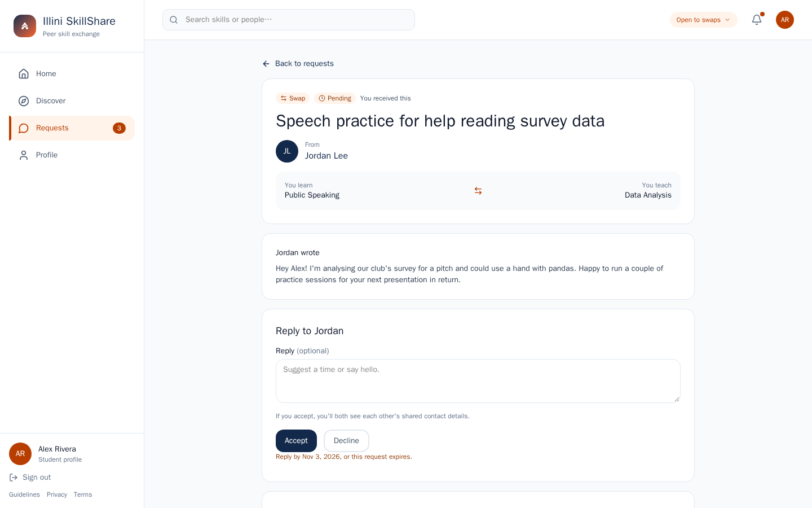
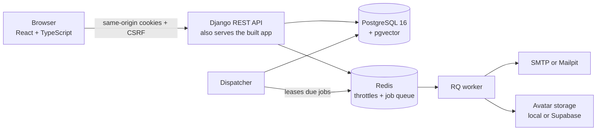

# Illini SkillShare

[](https://github.com/adhvikrayaprolu/uiuc-skillshare/actions/workflows/ci.yml)


**Trade what you know for what you want to learn.** Illini SkillShare matches University of Illinois students who can teach each other: you teach Python, they teach you Figma. When nobody is a two-way match, you can still ask someone for help. Contact details are shared only after a request is accepted, and both people leave feedback when it's done.

▶ **[Watch the demo video](docs/demo/tour.webm)** (30 seconds), or run it yourself with the two-command [quick start](#quick-start) and click **Try the demo**.


## Highlights

- **Two-way swap matching.** It finds members who teach one of your learning goals *and* want to learn something you teach, and explains every match ("They teach you Figma ⇄ You teach them Python").
- **Consent before contact.** Django enforces it: contact details appear only to the other person in an accepted request. Private profiles, blocking and reporting apply everywhere, including search, notifications and email.
- **A complete request lifecycle.** Pending, accepted, completed, with version checks, idempotency keys, a cap of five waiting requests, 14-day expiry with a reminder on day 7, and two-way reviews and endorsements on swaps.
- **Retention without dark patterns.** Cold-start hints, an invite link, skill alerts when someone new teaches your goals, and an opt-in weekly digest sent through a retrying email outbox.
- **Trust and safety.** Reason-coded reports go to a staff moderation queue with an audit trail. Policy pages, account export and confirmed deletion are built in.
- **Launch basics.** Per-screen titles, Open Graph cards, a sitemap, `noindex` on signed-in screens, a crash-recovery screen, scrubbed first-party error reports and staff launch metrics.
- **Tested like a product.** PostgreSQL regression tests, frontend unit tests, a two-member Chromium journey, an axe accessibility sweep of every screen, a backup and restore rehearsal, and a smoke test of the quick start. All of it runs in CI.

## Product tour

| | |
|---|---|
|  **Landing.** What a swap is, with a one-click demo in local development. |  **Swap matches.** Two-way matches, each with its reason. |
|  **Discover.** Keyword and taxonomy search with filters and explainable ranking. |  **Profile.** Why you matched, plus skills, goals, availability and feedback. |
|  **Requests.** Needs action, Active and Past, sorted on the server. |  **Request detail.** Accept or decline, then contacts, completion and feedback. |
|  **Launch metrics.** Staff-only success measures computed from real records. |   **Mobile.** The same four-item navigation on phones. |

The screenshots and the video come from the seeded demo account, and everyone in it is fictional. `make screenshots` regenerates them with a headless browser.

## Quick start

Requirements: Docker with Compose v2 (give Docker about 4 GB of memory), Make and Python 3.

```bash
make setup
```

```bash
make dev
```

Open **http://localhost:8080** and click **Try the demo** to sign in as Alex, a sample student who already has swaps, requests and feedback. On the sign-in page, **Or view the demo moderator screens** opens the staff launch metrics.

- `make setup` checks that Docker is running, creates `.env` from `.env.example` with a fresh local secret key (an existing `.env` is never overwritten), and builds the images.
- `make dev` starts PostgreSQL, Redis, a local mail inbox, the app, the worker and the job dispatcher. It migrates the database, seeds the skill taxonomy and the demo network, and waits until every service is healthy.
- You can also sign in with any `@illinois.edu` address: the code arrives in the local inbox at **http://localhost:8025**.
- `make stop` stops everything and keeps your data, `make reset-demo` rebuilds the demo network, and `make logs` follows the app and workers.

Without Make, `docker compose up --build --wait` works with no configuration at all.

## Optional integrations

Everything runs locally with no accounts or keys. Each integration below is optional, and the UI shows only the ones that are configured.

| Integration | Variables | When it's not configured |
|---|---|---|
| Google sign-in | `GOOGLE_CLIENT_ID`, `GOOGLE_CLIENT_SECRET` (the same client ID is built into the frontend) | The Google button is hidden, and email codes work. |
| Email delivery | `EMAIL_HOST`, `EMAIL_PORT`, `EMAIL_USE_TLS`, `EMAIL_HOST_USER`, `EMAIL_HOST_PASSWORD`, `DEFAULT_FROM_EMAIL` | Local Compose delivers to the Mailpit inbox. Production refuses to start without SMTP. |
| AI-assisted matching | `AI_PAID_CALLS_ENABLED`, `AI_DAILY_CALL_LIMIT`, `OPENAI_API_KEY` | Off by default with a $0 allowance. Search uses keyword and taxonomy ranking, which needs no outside service. |
| Private avatar storage | `AVATAR_STORAGE=supabase`, `SUPABASE_URL`, `SUPABASE_AVATAR_BUCKET`, `SUPABASE_STORAGE_KEY` | Avatars are stored on a local volume. |
| Error reports | `CLIENT_ERROR_REPORTING`, `VITE_RELEASE` | On by default. Scrubbed browser errors go to the app's own database, where staff read them in Django admin. |

Core settings are `ENVIRONMENT`, `SECRET_KEY`, `DEBUG`, `ALLOWED_HOSTS`, `APP_PUBLIC_URL`, `DATABASE_URL`, `DB_SCHEMA`, `DB_SSLMODE`, `DB_SSLROOTCERT`, `REDIS_URL` and `DEMO_MODE` (local only). Production settings refuse development secrets, unencrypted database connections, missing Redis or SMTP, wildcard hosts and `DEMO_MODE`. The full production template is [`.env.production.example`](.env.production.example), and the hosting steps are in [operations](docs/operations.md).

## Architecture



### Key design decisions

- **The server is the authority.** Every rule (membership, privacy, blocking, contact consent, request transitions, feedback eligibility) is enforced in Django. The React app only reflects the rules, so a modified client can't skip one.
- **Sessions, not tokens.** It uses allauth browser sessions with CSRF, served from one origin, so no tokens sit in `localStorage`. In development, Vite proxies `/api` to Django so cookies and CSRF behave the same way.
- **Durable side effects.** Request and feedback transactions write notification and email-outbox rows in the same database transaction. A dispatcher leases due rows to RQ with retries and backoff, so a Redis or SMTP outage delays email without losing it.
- **Explainable, bounded matching.** Keyword and taxonomy ranking gives a reason for every result and caps candidates at 200. Paid embeddings sit behind consent, a kill switch and a daily allowance that defaults to zero ([matching design](docs/matching.md)).
- **Least-privilege database roles.** The app connects with a runtime role that can't change the schema, and only the one-shot migration service uses the owner role. A disposable rehearsal proves backup and restore work.
- **Demo data that can't reach production.** `DEMO_MODE` seeds a fictional network for local use only. Settings refuse it outside `ENVIRONMENT=local`, and the production check verifies that.

### Tech stack

| Layer | Tools |
|---|---|
| Frontend | React 18, TypeScript (strict), Vite, Tailwind CSS 4, React Router 7, TanStack Query, Vitest, Testing Library |
| Backend | Python 3.13, Django 5.2, Django REST Framework, drf-spectacular (OpenAPI), django-allauth, django-rq, Gunicorn, WhiteNoise |
| Data | PostgreSQL 16 with pgvector, Redis 7 |
| Testing | Django tests on PostgreSQL, Playwright with axe-core, a standard-library smoke test |
| Delivery | Docker Compose, GitHub Actions, Dependabot |

## Testing and CI

```bash
make check
```

`make check` runs everything in its own Compose project with demo data off, then removes that project, so it never touches your dev database. It covers:

- Django system checks, OpenAPI schema validation and a migration drift check
- PostgreSQL regression tests for authorization, privacy, concurrency, rollbacks, provider failures, rate limits, request expiry, alerts and metrics
- Frontend unit tests, lint, a strict type check and the production build
- A two-member Chromium journey (email-code sign-in, setup, swap, accept, complete, feedback, report, block, email alerts, account deletion) with axe WCAG checks and mobile overflow checks
- Production-settings and database-permission checks, and a backup and restore rehearsal

With `make dev` running, two more checks use the demo network:

- `make smoke` runs [`scripts/smoke.py`](scripts/smoke.py) through the app's public origin. It checks health, pages and share tags, signed-out refusal, CSRF, demo sign-in, Home, swaps, search, the inbox, a request, save and unsave, and sign-out.
- `make a11y` runs axe on every screen at desktop and phone widths as a visitor, the demo student and the demo moderator, and fails on any console error or failed request.

[CI](.github/workflows/ci.yml) runs on every pull request and on `main`:

| Job | What it proves |
|---|---|
| Backend, browser journey and recovery | The `make check` stages above, on PostgreSQL |
| Frontend | `tsc -b`, ESLint, Vitest and the Vite build on the pinned Node version |
| README quick start, smoke test and accessibility sweep | `make setup` and `make dev` work on a clean runner, setup leaves `.env` alone, then `make smoke` and `make a11y` pass |
| Dependency audit (non-blocking) | `pip-audit` and `npm audit` |

Runtime versions are pinned in [`.nvmrc`](.nvmrc) and [`.python-version`](.python-version). Dependabot groups patch and minor updates separately from major ones. The [release workflow](.github/workflows/release.yml) is manual, and until hosting exists it only builds and checks the production image.

## API overview

Interactive docs are at **http://localhost:8080/api/docs/** (OpenAPI at `/api/schema/`). The [frontend API contract](backend/docs/frontend_api_contract.md) describes each endpoint's behavior.

| Area | Endpoints |
|---|---|
| Auth | `GET /api/auth/csrf/`, `POST /api/auth/email/request/`, `POST /api/auth/email/confirm/`, `POST /api/auth/google/`, `GET/PATCH /api/auth/me/`, `POST /api/auth/logout/`, `GET /api/auth/export/`, `POST /api/auth/delete/`, `POST /api/auth/demo/` (local only) |
| Profiles | `GET/PATCH /api/profiles/me/`, `GET /api/profiles/{id}/`, plus skills, availability, contact methods, links and avatar |
| Discovery | `GET /api/discovery/search/`, `/swaps/`, `/recommended/`, `/community/` |
| Requests | `GET/POST /api/help-requests/?bucket=needs_action\|active\|past`, `GET/PATCH /api/help-requests/{id}/`, reviews, endorsements |
| Safety | `POST /api/reports/`, `GET/POST/DELETE /api/blocked-users/` |
| App | `GET /api/dashboard/`, `/api/notifications/`, `/api/health/live/`, `/api/health/ready/`, `POST /api/client-errors/` |

## Project structure

```text
backend/    Django apps: accounts, profiles, taxonomy, discovery, interactions, common
frontend/   React app (src/pages, components, hooks, lib), browser journey (e2e), tour and sweep (e2e-tour)
scripts/    setup, smoke test, native dev helpers, database roles and recovery rehearsal
docs/       matching, operations, readiness, development, screenshots and the demo video
```

More: [development](docs/development.md) · [operations and hosting](docs/operations.md) · [launch readiness](docs/readiness.md) · [product direction](CONTEXT.md) · [backend](backend/README.md) · [frontend](frontend/README.md).

An Illinois email gives access; it doesn't mean university approval or verified enrollment. This is a student project, not affiliated with or endorsed by the University of Illinois.
